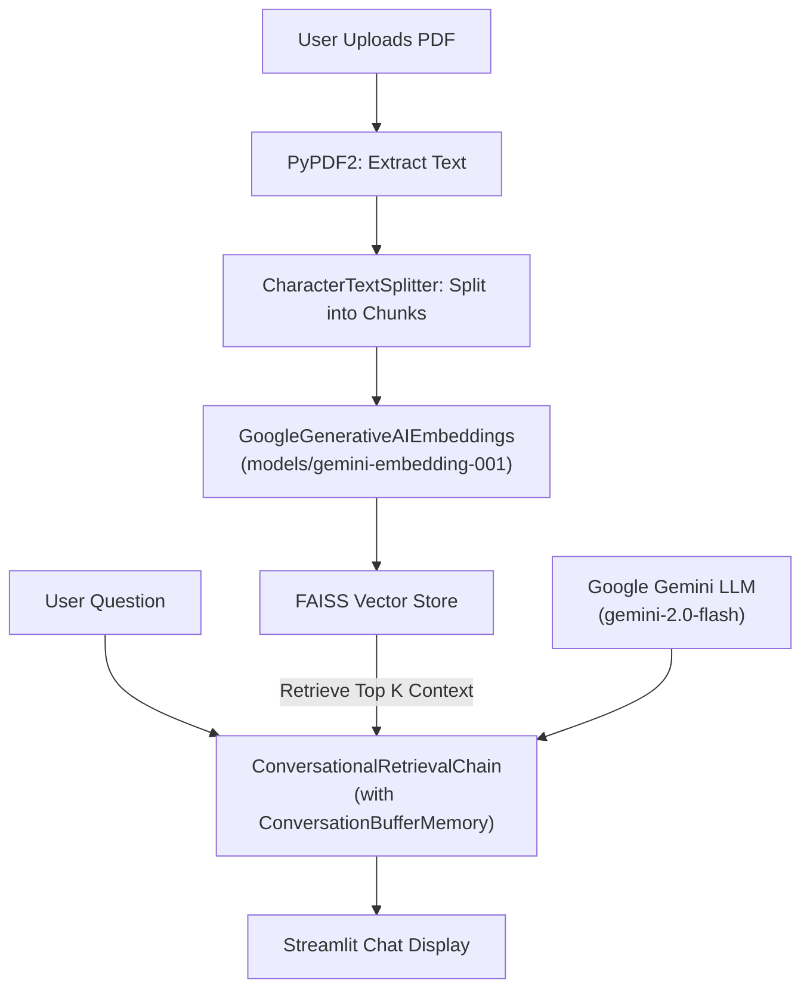

# LangChain PDF Assistant

A conversational question-answering assistant powered by **LangChain**, **Google Gemini**, and **Streamlit**. Upload any PDF document and ask questions to get context-aware answers grounded directly in your document's contents using Retrieval-Augmented Generation (RAG).

---

## Features

- **Document Processing:** Extract text from uploaded PDF files seamlessly via `PyPDF2`.
- **Text Chunking:** Splits extracted content into manageable chunks with overlap using `CharacterTextSplitter`.
- **Semantic Embeddings:** Generates vector embeddings for document chunks using Google's `models/gemini-embedding-001`.
- **Local Vector Search:** Fast vector similarity search with `FAISS` vector store.
- **Conversational Retrieval:** Answers questions using `gemini-2.0-flash` with conversational memory (`ConversationBufferMemory`) to retain chat context across questions.
- **Clean Streamlit UI:** Simple and intuitive interactive web interface.

---

## Architecture



---

## Tech Stack

| Component | Technology |
|---|---|
| **Web Interface** | [Streamlit](https://streamlit.io/) |
| **PDF Extraction** | [PyPDF2](https://pypdf2.readthedocs.io/) |
| **Orchestration** | [LangChain](https://www.langchain.com/) (`langchain-classic`, `langchain-community`) |
| **Embeddings** | `models/gemini-embedding-001` via `langchain-google-genai` |
| **LLM** | `gemini-2.0-flash` via `langchain-google-genai` |
| **Vector Store** | [FAISS](https://github.com/facebookresearch/faiss) (`faiss-cpu`) |
| **Environment Management** | `python-dotenv` |

---

## Project Structure

```text
langchain-pdf-assistant/
├── app.py              # Main Streamlit application entry point
├── requirements.txt    # Python package dependencies
├── .env.example        # Environment variable template
├── .gitignore          # Git exclusion rules
└── README.md           # Project documentation
```

---

## Prerequisites

- Python 3.10 or higher
- A Google Gemini API key ([Get one free from Google AI Studio](https://aistudio.google.com/))

---

## Installation & Setup

### 1. Clone the repository

```bash
git clone https://github.com/devanshbansal3912/langchain-pdf-assistant.git
cd langchain-pdf-assistant
```

### 2. Create and activate a virtual environment

**On Windows (PowerShell):**
```powershell
python -m venv .venv
.\.venv\Scripts\Activate.ps1
```

**On macOS / Linux:**
```bash
python3 -m venv .venv
source .venv/bin/activate
```

### 3. Install dependencies

```bash
pip install -r requirements.txt
```

### 4. Configure environment variables

Copy `.env.example` to `.env`:

```bash
cp .env.example .env
```

Edit `.env` and add your Google Gemini API key:

```env
GOOGLE_API_KEY=your_google_api_key_here
```

---

## Usage

Start the Streamlit application:

```bash
streamlit run app.py
```

1. Open your browser at `http://localhost:8501`.
2. Upload your PDF document using the file uploader.
3. Once processed, type your question into the input field.
4. View the conversation history and responses generated from your document.

---

## Security Notes

- Keep your `.env` file secret. It is ignored by `.gitignore` and should never be committed to version control.
- Never hardcode API keys directly into source files.
